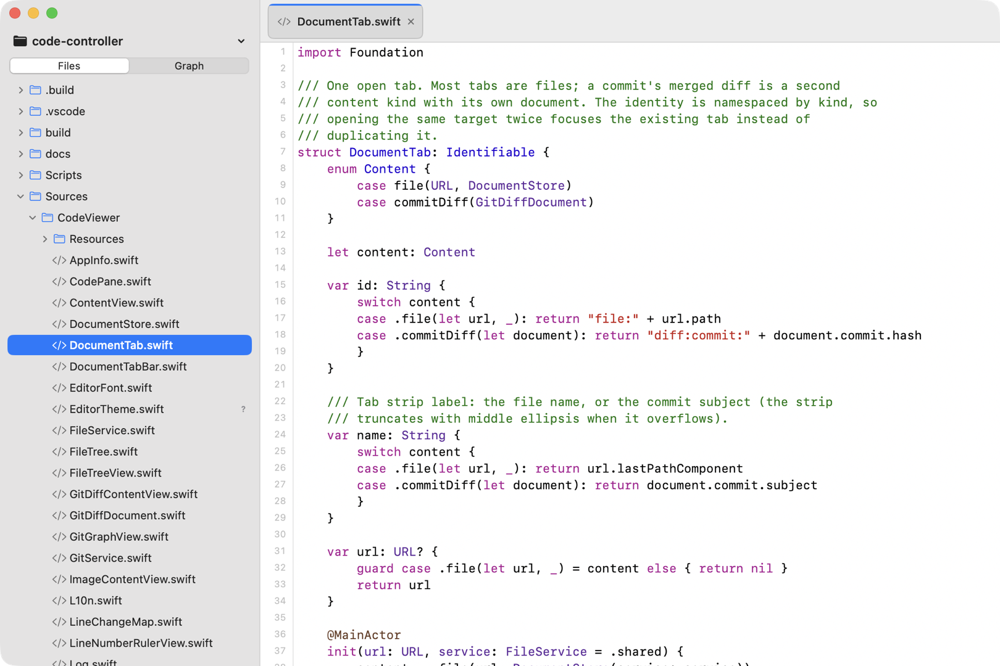

# CodeCtrl

[English](README.md) | [中文](README.ZH.md)

CodeCtrl 是一个用 SwiftUI + SwiftPM 构建的原生 macOS 代码查看器 —— 没有 `.xcodeproj`。把文件夹作为工作区打开，浏览目录树，在标签页里带语法高亮地阅读文件，并直接看到 git 对它们怎么说：文件和标签上的状态徽章、编辑器里标出的工作区改动、内联渲染的提交 diff。文件以只读方式打开，应用不会向你的工作区写入任何内容。

CodeCtrl 目前是 0.1 版本，仍在积极开发中。



## 系统要求

- macOS 14 Sonoma 或更高版本。
- Xcode 15 或更高版本（Swift 5.9 工具链）用于构建。SwiftPM 会在首次构建时拉取唯一的第三方依赖 [HighlighterSwift](https://github.com/smittytone/HighlighterSwift)。
- `PATH` 中有 `git` 才能使用 git 相关功能。它是可选的 —— 没有 git 时 CodeCtrl 就是一个普通的查看器，不显示徽章。
- `python3`（Xcode 命令行工具自带）只有 `Scripts/make-app.sh` 组装 `.app` 时才需要。

## 功能

- **工作区侧边栏**：通过工作区菜单或拖拽添加文件夹；每个工作区根据路径分配一个稳定的彩色标识块。侧边栏提供「文件 / 提交」面板切换，使用系统原生半透明材质，并延伸到透明标题栏的交通灯下方。
- **文件树**：懒加载的递归目录树（文件夹在前，再按名称排序），悬停高亮，右键菜单（打开、在 Finder 中显示），每行带 Git 状态徽章。
- **快速打开（⌘P）**：工作区上方的浮动搜索面板。每次打开重新扫描，文件名大小写不敏感匹配（无命中时回退到相对路径匹配），命中部分在文件名中高亮，↑/↓ + Enter 键盘导航，Esc 或点击面板外关闭。
- **文档标签页**：每个文件一个标签，标题中间截断、两行折行、可关闭，并带同样的 Git 状态徽章；右键菜单可以关闭其他标签或左侧 / 右侧的全部标签。⌘W 关闭当前标签（无标签时不会关掉窗口）；⌘1…⌘9 切换标签。编辑器视图以 LRU 池复用（8 个），切换标签保留滚动位置和选区。图片文件（PNG、JPEG、GIF、WebP、HEIC、HEIF、TIFF、BMP、AVIF、SVG）打开为按比例适配的预览——动图照常播放，超大文件仍受统一大小上限约束，损坏文件回落到二进制提示。提交的合并 diff 以独立标签类型打开，配 Git 专属图标。
- **语法高亮**：highlight.js（经 HighlighterSwift）在后台 actor 上运行，通过 `SyntaxHighlighter` 协议抽象、便于日后替换引擎。高亮结果按文档版本、主题和编辑器字体缓存（LRU，12 条）；输出会重新套用编辑器字体和固定行高，行号尺不错位；浅色 / 深色外观各配一个编辑器主题（13 个精选 highlight.js 主题，均使用主题自身背景色渲染）。
- **Git 集成**：在工作区根目录探测仓库，未装 git 或非仓库时优雅降级；`git status` 的 M/A/D/? 徽章显示在文件树和标签上（⌘R 刷新文件树、状态、提交列表和当前文档）。只使用只读的 git 命令（`status`、`diff`、`log`、`show`）。
- **编辑器内显示改动行**：与 HEAD 有差异的文件打开后，工作区改动会像 diff 一样标出来——只新增的行是绿色底，替换了被删内容的行是黄色底，整块被删除的位置在行号栏留一个红色缺口标记，改动行号右侧还有实心的绿 / 黄竖条。标记取自工作区（`git diff HEAD`，暂存和未暂存的改动都算），文件变化时刷新，文件恢复干净后自动消失。
- **提交历史**：侧边栏「提交」面板列出最近提交——信息、作者、相对时间、分支徽章——点击任意提交在标签页中打开合并 diff：该提交的所有文件自上而下堆叠，每个文件渲染为 inline diff（新旧双行号列、整行绿/红底色、静态「N 行已隐藏」折叠带、按语言语法高亮）。
- **自动刷新**：每个工作区一个 FSEvents 监听，事件突发经 debounce 合并；文件树、Git 状态和发生变化的已打开文档自动刷新。未变化的文档通过 mtime/size 检测跳过，高亮缓存不受无关变动影响。
- **设置窗口**：侧边栏分四类——通用（界面语言）、外观（系统 / 浅色 / 深色主题）、编辑器（浅色 / 深色高亮主题 + 实时预览、编辑器字体和字号）、快捷键（固定快捷键一览）——选择会被持久化并应用到全局；独立固定尺寸窗口，通过 App 菜单的 ⌘, 打开。
- **持久化**：工作区列表以 security-scoped bookmark 的形式存于 UserDefaults（App Store 沙盒构建在重启后仍可访问；失效文件夹会被过滤），窗口框架由系统在重启后恢复。
- **本地化**：支持英文和简体中文，默认跟随系统语言，可在设置中覆盖（重启后生效）。
- **诊断**：结构化统一日志会同步写入轮转文件日志，启动横幅会记录 bundle、沙盒和日志路径。
- 自动适配浅色 / 深色外观。

## 键盘快捷键

| 按键 | 功能 |
| --- | --- |
| `⌘P` | 前往文件…（快速打开） |
| `⌘W` | 关闭当前标签 |
| `⌘1`…`⌘9` | 切换到第 1 到第 9 个标签 |
| `⌃⌘S` | 显示 / 隐藏侧边栏 |
| `⌘R` | 刷新文件树、Git 状态、提交列表和当前文档 |
| `⌘,` | 打开设置 |

快捷键是固定的，不可自定义；设置 → 快捷键里有同样的列表。

## 快速开始

从源码构建并运行：

```bash
git clone https://github.com/pangzi-club/code-controller.git
cd code-controller
swift run          # 调试构建并运行 —— 或：make dev
```

注意：`swift run` 执行的是裸二进制，Launch Services 会把它当作后台进程 —— 没有 Dock 图标，也没有自己的菜单栏。想要完整体验，需要组装应用包：

```bash
make launch        # 产物：build/CodeCtrl-Dev-<本机架构>.app，并打开
make app           # 产物：build/CodeCtrl.app —— universal（arm64 + x86_64）
make install       # 构建 universal 包，然后替换 /Applications/CodeCtrl.app
```

运行测试（Swift Testing）：

```bash
swift test          # 或：make test
make check-l10n     # 校验两份 Localizable.strings 的键一致
```

`make help` 列出 `Makefile` 提供的全部命令。

## 构建与打包

`Scripts/make-app.sh` 按 `ARCHS` 指定的架构构建 release 包：`make app` 默认把 arm64 和 x86_64 lipo 合并成单个 universal `build/CodeCtrl.app`，同一份包在 Apple Silicon 和 Intel Mac 上都原生运行；可用 `ARCHS` 覆盖，例如 `ARCHS=arm64 make app` 构建本机架构的瘦包，或 `ARCHS="arm64 x86_64" make app` 每个架构各出一个包（`build/CodeCtrl-<架构>.app`）。每个包都会生成应用图标（`Scripts/make-icon.swift` 程序化绘制）、根据 `AppInfo.swift`（显示名、bundle ID、营销版本、构建号）和 `Package.swift`（最低 macOS 版本）生成 Info.plist，并复制隐私清单。`make app` 会使用 `Scripts/App.entitlements` 签名，优先使用 Developer ID 证书，没有则退回 ad-hoc 签名；可用 `SIGN_IDENTITY` 指定身份。本地和 Developer ID 构建**默认不开启沙盒**，需要本地或 hardened runtime 权限时往该文件里加。

App Store 构建开启 App Sandbox，因此 CodeCtrl 用 app-scoped security bookmark 持久化工作区，而不是只存路径——仅凭路径在重启后会失去访问权限。沙盒会把 Application Support、UserDefaults 和缓存移入 `~/Library/Containers/<bundleID>/Data`，所以 `swift run` 或 `make app` 期间保存的工作区和偏好不会带到 App Store 构建。生成的 `Info.plist` 会声明 `CFBundleLocalizations`，让 AppKit 标准菜单跟随应用内语言。

`make launch` 为本机架构构建独立的开发身份：bundle ID 追加 `.dev`，显示名追加 `-Dev`。TCC 授权和 UserDefaults 都以 bundle ID 区分（开启沙盒时还包括容器），因此反复重建开发版不会让正式版的权限失效（反之亦然）。

### App Store

```bash
make mas                    # 产物：build/CodeCtrl-0.1-1.pkg
```

`make mas` 使用 Apple Distribution 签名并生成供 Transporter 使用的 `.pkg`；包内是单个 universal（arm64 + x86_64）沙盒应用。它使用 `Scripts/App.sandbox.entitlements`，如果该文件没有开启 App Sandbox 会直接报错。每次上传前递增 `AppInfo.build`（对应 `CFBundleVersion`）；`CFBundleShortVersionString` 来自 `AppInfo.version`。普通 App Store 提交不需要 provisioning profile，但 TestFlight 需要——传入 `PROVISION_PROFILE=...` 即可嵌入。公证（notarization）只用于 Developer ID 分发，不用于 App Store。`INSTALLER_IDENTITY` 可覆盖安装器证书。

如果应用需要读取受 TCC 保护的文件夹（下载、桌面、文稿、相机、麦克风等），请在 `Scripts/make-app.sh` 的 Info.plist heredoc 中加入对应的 `NS*UsageDescription`，并提供 `Contents/Resources/<lang>.lproj/InfoPlist.strings` 本地化副本，让系统授权弹窗跟随用户语言。

## 开发

### 测试

测试使用 Swift Testing，位于 `Tests/CodeViewerTests/`，覆盖纯逻辑（diff 解析、改动行映射、快速打开匹配、store 和辅助函数）。`LocalizationTests` 还会检查键对齐、空值和每个枚举 label 键，所以任何一份目录里缺字符串都会让 `swift test` 失败。文件系统测试的 fixture 建在 `FileManager.temporaryDirectory` 下。

### 验证 UI

窗口帧恢复、设置窗口、焦点环、空状态、深色模式和本地化只存在于组装后的应用里 —— 务必用 `make app` 的产物验证，而不是裸 `swift run` 二进制。`docs/ui-testing.md` 是 AX + `screencapture` + CGEvent 的验证手册，包含辅助脚本源码和每次改动的检查清单。

### Xcode Preview

用 Xcode 打开 `Package.swift`（scheme 由 Xcode 自动生成；`.swiftpm/` 已被 gitignore）。包内有两个 target：**CodeViewer** library 包含全部视图、模型和 store；**CodeViewerApp** executable 只保留 `@main` 入口。Preview 必须依赖 library 产物 —— 命令行工具类型的 target 无法驱动画布 —— 因此各视图文件末尾的 `#Preview` 都走 library scheme。executable target 要用到的类型需要标记 `public`。需要文件数据的 Preview 使用 `PreviewFixtures`，它在临时目录里生成示例文件夹，而不是指向开发者本机路径。

### 诊断

`Log` 会把日志写入统一日志（subsystem = bundle ID），并同步镜像到 `~/Library/Logs/CodeCtrl/app.log`；启动时若文件超过 2 MB，会轮转为 `app.log.1`。App Store 构建的同一路径位于沙盒容器内（`~/Library/Containers/<bundleID>/Data/Library/Logs/...`）。`Log.bootstrap()` 会在首个窗口出现前记录 bundle、沙盒和日志路径。实时查看：

```sh
/usr/bin/log stream --predicate 'subsystem == "<bundleID>"' --level debug
```

### 本地化说明

SwiftPM 构建时会把资源包里的 `.lproj` 目录名转成小写，而 `Bundle` 的资源名查找是大小写敏感的，导致系统语言偏好 `zh-Hans` 无法匹配到 `zh-hans.lproj`。`L10n` 自行根据设置中的语言覆盖项（如果有的话）和 `Locale.preferredLanguages` 判断语言，并显式加载对应的 `en` 或 `zh-Hans` 的 `.lproj` 包 —— 使用多语言 module bundle 会跟随系统语言，忽略语言覆盖。界面语言在启动时固定 —— 字符串在视图构建时就已写入 —— 所以修改语言设置后需要重启应用才能生效。所有面向用户的字符串都通过 `l10n()` / `l10nString()` 以英文键查找，每个新键必须同时加到两份目录里；改动任一目录后运行 `make check-l10n`。

## 基于本项目开发新应用

CodeCtrl 脱胎于一个 SwiftUI + SwiftPM 起步模板，并保留了它的工具链。基于本仓库开发新应用时，一条命令完成整体重命名：

```bash
./Scripts/rename.sh MyApp com.you.MyApp
```

脚本会重命名 `Package.swift` 中的包和 target、移动 `Sources/` 与 `Tests/` 目录（executable target 会变成 `MyAppApp`）、重命名 `@main` 结构体，并更新 `AppInfo.swift` 中的身份信息（未指定 bundle ID 时默认 `com.example.<NewName>`）、README、`AGENTS.md` 和 `docs/`。脚本结束时会列出仍包含旧名称的文件，避免后续新增的配置或脚本被静默遗漏。

`TEMPLATE.md` 记录起步模板的版本和仍跟随模板的文件清单。在 fork 中运行 `make template-diff SOURCE=/path/to/swiftui-starter` 即可查看差异；脚本只读，应用特有的改动可以手工合并。

## 参与贡献

欢迎提 issue 和 pull request。提 PR 前请运行 `swift test` 和 `make check-l10n`。`AGENTS.md` 记录了代码库的约定（本地化键必须同时进两份目录、日志走 `Log`、编辑器 / 行号尺的行高契约）和已知的坑。

## 项目结构

SwiftPM 的 target 和目录名仍沿用项目最初的 `CodeViewer`；产品名（`CodeCtrl`）只在 `AppInfo.swift` 里。

```
Sources/
├── CodeViewer/                 # Library target：全部视图、模型、store
│   ├── AppInfo.swift             # 显示名 / bundle ID / 版本 / 构建号（唯一事实来源）
│   ├── ContentView.swift         # 分栏布局、详情页、标签页快捷键监听、窗口 chrome
│   ├── SidebarView.swift         # 工作区菜单 + 文件/提交面板切换
│   ├── WorkspaceStore.swift      # 工作区列表 + UserDefaults 中的 security bookmark
│   ├── WorkspaceSession.swift    # 每工作区的标签、目录树、git、监听器
│   ├── WorkspaceWatcher.swift    # FSEvents 监听 + debounce
│   ├── FileService.swift         # Actor：目录列表、文件读取、图片解码
│   ├── FileTree.swift            # 懒加载目录树 store
│   ├── FileTreeView.swift        # 带 Git 徽章的目录树行
│   ├── QuickOpen.swift           # ⌘P 快速打开面板：递归扫描、匹配、浮层 UI
│   ├── DocumentTab.swift         # 标签模型（文件或提交 diff，每标签一份文档）
│   ├── DocumentTabBar.swift      # 可折行的标签条 + 徽章
│   ├── DocumentStore.swift       # 每标签的文件文档：加载状态、变更后重载
│   ├── CodePane.swift            # LRU 池化 NSTextView 编辑器 + 固定排版度量
│   ├── LineNumberRulerView.swift # 由滚动偏移推导的行号栏
│   ├── ImageContentView.swift    # 按比例适配的图片预览
│   ├── LineChangeMap.swift       # 工作区改动行标记 + 编辑器底色和行号栏颜色
│   ├── SyntaxHighlighting.swift  # SyntaxHighlighter 协议、HighlighterSwift 适配、缓存
│   ├── EditorFont.swift          # 编辑器字体设置：字体族 + 字号、行高度量与等宽字体族列表
│   ├── GitService.swift          # git CLI：status/diff/log/show + 可观察状态 store
│   ├── GitGraphView.swift        # 提交历史面板
│   ├── GitDiffDocument.swift     # 提交 diff 文档（加载状态 + 高亮缓存）
│   ├── GitDiffContentView.swift  # inline 提交 diff 标签视图
│   ├── UnifiedDiff.swift         # unified diff 解析 + 行模型
│   ├── SettingsStore.swift       # 主题、语言、编辑器主题/字体偏好与持久化
│   ├── SettingsView.swift        # 设置窗口：通用/外观/编辑器/快捷键四类面板
│   ├── Support.swift             # 共享辅助：文件类型图标、通知名、主窗口跟踪
│   ├── L10n.swift                # 本地化辅助
│   ├── Log.swift                 # 统一日志 + 轮转文件日志
│   ├── PreviewFixtures.swift     # 仅 DEBUG 的 Xcode Preview 示例文件夹
│   └── Resources/
│       ├── en.lproj/Localizable.strings
│       ├── zh-Hans.lproj/Localizable.strings
│       └── PrivacyInfo.xcprivacy  # required-reason API 声明
└── CodeViewerApp/
    └── CodeViewerApp.swift     # 薄 @main 入口、窗口场景、App 菜单命令
Tests/CodeViewerTests/          # Swift Testing 测试
Scripts/
├── App.entitlements              # 本地/Developer ID 权限（不沙盒）
├── App.sandbox.entitlements      # App Store：沙盒 + 用户选择文件 + bookmark
├── check-l10n.py                 # 本地化键对齐校验
├── make-app.sh                   # 按架构构建 release + .app/.pkg 组装
├── make-icon.swift               # 应用图标程序化生成
├── rename.sh                     # 面向 fork 的一键重命名
└── template-diff.sh              # 与起步模板的只读差异检查
docs/
└── ui-testing.md                 # AX + screencapture + CGEvent 验证手册
TEMPLATE.md                       # 起步模板版本、托管文件与合并规则
AGENTS.md                         # 面向人和 agent 的约定与坑位说明
.vscode/launch.json               # VS Code Swift 扩展的 Debug/Release 启动配置
```

## 第三方许可证

- [HighlighterSwift](https://github.com/smittytone/HighlighterSwift) —— MIT 许可证 —— 语法高亮引擎；它内置了 [highlight.js](https://highlightjs.org)（BSD-3-Clause）。

## 许可证

Apache License 2.0 —— 见 [LICENSE](LICENSE)。
