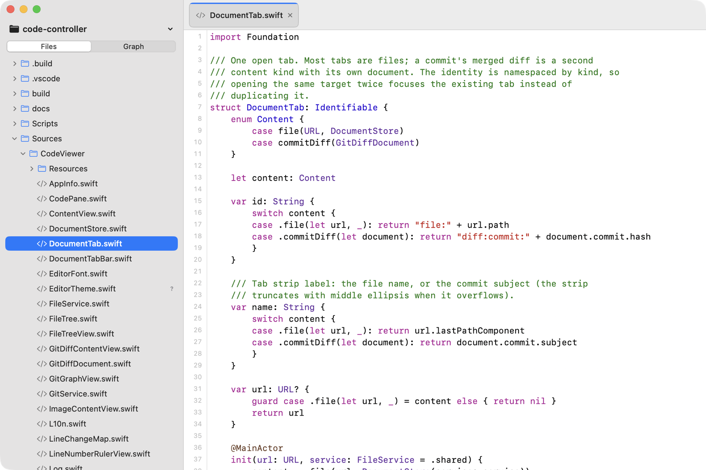

# CodeCtrl

[English](README.md) | [中文](README.ZH.md)

CodeCtrl is a native macOS code viewer built with SwiftUI and SwiftPM — there
is no `.xcodeproj`. Open a folder as a workspace, browse its tree, read files
in tabs with syntax highlighting, and see what git says about them: status
badges on files and tabs, working-tree changes tinted in the editor, and
commit diffs rendered inline. Files open read-only, and the app never writes
to your workspace.

CodeCtrl is at version 0.1 and under active development.



## Requirements

- macOS 14 Sonoma or later.
- Xcode 15 or later (Swift 5.9 toolchain) to build. SwiftPM fetches the single
  third-party dependency, [HighlighterSwift](https://github.com/smittytone/HighlighterSwift),
  on the first build.
- `git` on `PATH` for the git features. It is optional — without it CodeCtrl
  works as a plain viewer and shows no badges.
- `python3` (part of Xcode's Command Line Tools) is needed only by
  `Scripts/make-app.sh` when assembling a `.app`.

## Features

- **Workspaces sidebar**: add folders from the workspace menu or by dragging them in; each gets a stable color tile derived from its path. The sidebar hosts a Files/Graph pane switch, uses the native translucent material, and extends under the transparent titlebar to the traffic lights.
- **File tree**: lazily loaded recursive tree (directories first, then by name) with hover highlighting, context menus (Open, Show in Finder) and per-row git status badges.
- **Quick open (⌘P)**: a floating search panel over the workspace. It rescans on every open, matches file names case-insensitively (falling back to relative-path matches), highlights the hit in the name, and navigates with ↑/↓ + Enter; Esc or a click outside dismisses it.
- **Document tabs**: one tab per file with middle-truncating titles, two-row wrapping, a close button and the same git status badge; the context menu closes the other tabs or everything to the left/right. ⌘W closes the selected tab (does nothing with no tabs open, so it never takes the window down); ⌘1…⌘9 switch tabs. Views are pooled in an LRU (8 entries) so switching tabs preserves scroll position and selection. Image files (PNG, JPEG, GIF, WebP, HEIC, HEIF, TIFF, BMP, AVIF, SVG) open as scaled-to-fit previews — animated formats play, oversized files still hit the shared size limit, and corrupted ones fall back to the binary-file notice. A commit's merged diff opens as its own tab kind with a git-flavored icon.
- **Syntax highlighting**: highlight.js (via HighlighterSwift) running on a background actor, with a `SyntaxHighlighter` protocol seam for future engines. Finished results cache per document version, theme and editor font (LRU, 12 entries); the styled output is re-pinned to the editor font and pinned line height so the line-number ruler never shifts; separate editor themes for light and dark appearance (13 curated highlight.js themes, each rendered on its own background).
- **Git integration**: repository detection at the workspace root with graceful degradation when git is missing; `git status` badges (M/A/D/?) on tree rows and tabs (⌘R refreshes tree, statuses, commits and the selected document). Only read-only git commands are used (`status`, `diff`, `log`, `show`).
- **Changed lines in the editor**: a file that differs from HEAD opens with its working-tree changes drawn in, diff-style — green rows for lines the diff only adds, yellow rows for lines that replace removed content, a red seam marker in the line-number gutter where a block was removed outright, and solid green/yellow bars next to the numbers of changed lines. Marks follow the working tree (`git diff HEAD`, so staged and unstaged edits both count), refresh on watcher events and disappear when the file is reverted or clean.
- **Commit history**: a Graph pane in the sidebar listing recent commits — subject, author, relative date, branch badge — click one to open its merged diff as a tab: every changed file stacked top to bottom, each rendered as an inline diff with old/new line-number gutters, green/red row tints, static "N hidden lines" bands and per-language syntax highlighting.
- **Live refresh**: FSEvents watch per workspace with debounced bursts; the tree, git statuses and changed open documents refresh automatically. Unchanged documents are skipped via mtime/size checks so highlight caches survive unrelated churn.
- **Settings window**: a sidebar with four panes — General (interface language), Appearance (system/light/dark theme), Editor (light/dark highlight themes with a live preview, editor font family and size) and Shortcuts (a reference list of the fixed keyboard shortcuts) — persisted and applied app-wide; a separate fixed-size window opened with ⌘, from the App menu.
- **Persistence**: the workspace list is stored as security-scoped bookmarks in UserDefaults (so the sandboxed App Store build keeps access across relaunches; stale folders are dropped), and the system restores the window frame across relaunches.
- **Localization**: English and Simplified Chinese, following the system language by default with an override in Settings (takes effect on relaunch).
- **Diagnostics**: structured unified logging mirrored to a rotating file log, with a launch banner that records the bundle, sandbox and log paths.
- Adapts to light and dark appearance.

## Keyboard Shortcuts

| Keys | Action |
| --- | --- |
| `⌘P` | Go to File… (quick open) |
| `⌘W` | Close the selected tab |
| `⌘1`…`⌘9` | Select the first to ninth tab |
| `⌃⌘S` | Toggle the sidebar |
| `⌘R` | Refresh the tree, git statuses, commits and the selected document |
| `⌘,` | Open Settings |

Shortcuts are fixed, not rebindable; the same list is shown in Settings → Shortcuts.

## Getting Started

Build and run from source:

```bash
git clone https://github.com/pangzi-club/code-controller.git
cd code-controller
swift run          # debug build and run — or: make dev
```

Note that `swift run` executes a bare binary, which Launch Services treats as a
background process — no Dock icon and no menu bar of its own. For the proper
app experience, assemble a bundle:

```bash
make launch        # build/CodeCtrl-Dev-<arch>.app, opened for you
make app           # build/CodeCtrl.app — universal (arm64 + x86_64)
make install       # universal build, then replace /Applications/CodeCtrl.app
```

Run the test suite (Swift Testing) with:

```bash
swift test          # or: make test
make check-l10n     # verify both Localizable.strings catalogs have the same keys
```

`make help` lists every shortcut the `Makefile` offers.

## Build and Packaging

`Scripts/make-app.sh` builds a release bundle for the requested architectures:
by default `make app` lipo-merges arm64 and x86_64 into one universal
`build/CodeCtrl.app`, so the same bundle runs natively on Apple Silicon and
Intel Macs. Set `ARCHS` to override, e.g. `ARCHS=arm64 make app` for a thin
host-arch bundle, or `ARCHS="arm64 x86_64" make app` for one bundle per
architecture (`build/CodeCtrl-<arch>.app`). Each bundle gets the generated app
icon (`Scripts/make-icon.swift` draws it programmatically), an Info.plist
written from `AppInfo.swift` (display name, bundle ID, marketing version and
build number) and `Package.swift` (minimum macOS), and a copy of the privacy
manifest. `make app` signs the bundle with `Scripts/App.entitlements` and uses
a Developer ID certificate when the keychain has one (ad-hoc fallback);
`SIGN_IDENTITY` overrides the choice. Local and Developer ID builds are
**not sandboxed** by default — add local or hardened-runtime entitlements to
that file when needed.

The App Store build is sandboxed, so CodeCtrl persists app-scoped security
bookmarks for its workspaces instead of plain paths — a path alone loses
access after relaunch. The sandbox moves Application Support, UserDefaults and
caches into `~/Library/Containers/<bundleID>/Data`, so workspaces and
preferences saved during `swift run` or `make app` do not carry over to the
App Store build. `CFBundleLocalizations` is declared in the generated
`Info.plist` so the standard AppKit menus follow the in-app language.

`make launch` builds a separate dev identity for the host architecture: the
bundle ID gets a `.dev` suffix and the display name a `-Dev` suffix. TCC grants
and UserDefaults are keyed by bundle ID (and, when sandboxed, the container),
so rebuilding the dev app does not invalidate the shipping app's permissions
(and vice versa).

### App Store

```bash
make mas                    # build/CodeCtrl-0.1-1.pkg
```

`make mas` signs with Apple Distribution and writes a `.pkg` for Transporter.
The package contains a single universal (arm64 + x86_64) sandboxed bundle. It
signs with `Scripts/App.sandbox.entitlements` and refuses to run unless App
Sandbox is enabled there. Bump `AppInfo.build` for every upload
(`CFBundleVersion`); `CFBundleShortVersionString` comes from `AppInfo.version`.
A normal App Store submission does not need a provisioning profile, but
TestFlight does — pass `PROVISION_PROFILE=...` to embed one. Notarization is
only for Developer ID distribution. `INSTALLER_IDENTITY` overrides the
installer certificate.

If the app reads TCC-protected folders (Downloads, Desktop, Documents, camera,
microphone, …), add the matching `NS*UsageDescription` keys to the Info.plist
heredoc in `Scripts/make-app.sh`, plus localized copies in
`Contents/Resources/<lang>.lproj/InfoPlist.strings`, so the system prompt
follows the user's language.

## Development

### Tests

Tests use Swift Testing and live in `Tests/CodeViewerTests/`. They cover pure
logic (diff parsing, line-change maps, quick-open matching, stores, helpers).
`LocalizationTests` also checks key parity, empty values and every enum label
key, so a string missing from either catalog fails `swift test`. File-system
tests build their fixtures under `FileManager.temporaryDirectory`.

### Verifying the UI

Window frame restoration, the settings window, focus rings, empty states, dark
mode and localization only exist in the assembled app — always verify them on
`make app` output, not the bare `swift run` binary. `docs/ui-testing.md` is
the AX + `screencapture` + CGEvent playbook, including the helper sources and
the per-change checklist.

### Xcode Previews

Open `Package.swift` in Xcode (it synthesizes the schemes; `.swiftpm/` is
gitignored). The package has two targets: the **CodeViewer** library with all
views, models and stores, and the **CodeViewerApp** executable that only holds
the `@main` entry point. Previews need a library product — a command-line-tool
target cannot power the canvas — so the views (each file ends in a `#Preview`
block) preview against the library scheme. Types used by the executable target
must be `public`. Previews that need files use `PreviewFixtures`, which builds
a sample folder under the temporary directory instead of pointing at a
developer's home path.

### Diagnostics

`Log` writes to unified logging (subsystem = bundle ID) and mirrors every line
to `~/Library/Logs/CodeCtrl/app.log`, rotated to `app.log.1` when it exceeds
2 MB at launch. The App Store build keeps the same path inside its sandbox
container (`~/Library/Containers/<bundleID>/Data/Library/Logs/...`).
`Log.bootstrap()` records the bundle, sandbox and log paths before the first
window appears. Stream live with:

```sh
/usr/bin/log stream --predicate 'subsystem == "<bundleID>"' --level debug
```

### Localization Notes

SwiftPM lowercases `.lproj` directory names in the built resource bundle, and
`Bundle` resource lookup is case-sensitive, so the stock CFBundle matching can
miss `zh-hans.lproj` for a `zh-Hans` user preference. `L10n` resolves the
language against the Settings override (if one is stored) and
`Locale.preferredLanguages`, and loads the matching `en` or `zh-Hans` `.lproj`
bundle explicitly — the multi-localization module bundle would follow the
system language and ignore the override. The language is fixed at launch —
strings are baked into views when they are built — so a changed setting asks
to be relaunched before it applies. Every user-facing string goes through
`l10n()` / `l10nString()` with the English key as the lookup key, and every new
key must be added to both catalogs; run `make check-l10n` after touching either.

## Forking the Project

CodeCtrl grew out of a SwiftUI + SwiftPM starter and still ships its tooling.
To start a new app from this repository, rename everything in one shot:

```bash
./Scripts/rename.sh MyApp com.you.MyApp
```

This renames the package and targets in `Package.swift`, moves `Sources/` and
`Tests/` (the executable target becomes `MyAppApp`), renames the `@main`
struct, and updates the identity in `AppInfo.swift` (the bundle ID defaults to
`com.example.<NewName>` when omitted), the READMEs, `AGENTS.md` and `docs/`.
It finishes by listing any file that still contains the old name, so configs
or scripts added later are visible instead of silently stale.

`TEMPLATE.md` records the starter revision and the files that still follow it.
In a fork, run `make template-diff SOURCE=/path/to/swiftui-starter` to see the
drift; the script is read-only, so app-specific additions can be merged by hand.

## Contributing

Issues and pull requests are welcome. Before opening a pull request, run
`swift test` and `make check-l10n`. `AGENTS.md` documents the codebase
conventions (localization keys in both catalogs, logging through `Log`, the
editor/ruler line-height contract) and the known gotchas.

## Project Layout

The SwiftPM targets and directories still carry the project's original
`CodeViewer` name; the product name (`CodeCtrl`) lives only in `AppInfo.swift`.

```
Sources/
├── CodeViewer/                 # Library target: all views, models, stores
│   ├── AppInfo.swift             # Display name / bundle ID / version / build (single source of truth)
│   ├── ContentView.swift         # Split layout, detail pane, tab key monitor, window chrome
│   ├── SidebarView.swift         # Workspace menu + Files/Graph pane switch
│   ├── WorkspaceStore.swift      # Workspace list + security bookmarks in UserDefaults
│   ├── WorkspaceSession.swift    # Per-workspace tabs, tree, git, watcher
│   ├── WorkspaceWatcher.swift    # FSEvents watcher with debounce
│   ├── FileService.swift         # Actor: directory listings, file reads, image decoding
│   ├── FileTree.swift            # Lazily loaded tree store
│   ├── FileTreeView.swift        # Tree rows with git badges
│   ├── QuickOpen.swift           # ⌘P quick-open panel: recursive scan, matching, overlay UI
│   ├── DocumentTab.swift         # Tab model (file or commit diff, per-tab document)
│   ├── DocumentTabBar.swift      # Wrapping tab strip with badges
│   ├── DocumentStore.swift       # Per-tab file document: load state, reload-if-changed
│   ├── CodePane.swift            # LRU-pooled NSTextView editors + pinned metrics
│   ├── LineNumberRulerView.swift # Line-number gutter derived from the scroll offset
│   ├── ImageContentView.swift    # Scaled-to-fit image preview
│   ├── LineChangeMap.swift       # Working-tree line marks + editor tints and ruler colors
│   ├── SyntaxHighlighting.swift  # SyntaxHighlighter protocol, HighlighterSwift adapter, cache
│   ├── EditorFont.swift          # Editor font setting: family + size, metrics and mono-family list
│   ├── GitService.swift          # git CLI: status/diff/log/show + observable status store
│   ├── GitGraphView.swift        # Commit history pane
│   ├── GitDiffDocument.swift     # Commit diff document (load state + highlight cache)
│   ├── GitDiffContentView.swift  # Inline commit diff tab view
│   ├── UnifiedDiff.swift         # Unified diff parser + inline row model
│   ├── SettingsStore.swift       # Theme, language, editor theme/font prefs and persistence
│   ├── SettingsView.swift        # Settings window: General/Appearance/Editor/Shortcuts panes
│   ├── Support.swift             # Shared helpers: file-type icons, notification names, main-window tracker
│   ├── L10n.swift                # Localization helpers
│   ├── Log.swift                 # Unified logging + rotating file log
│   ├── PreviewFixtures.swift     # DEBUG-only sample folder for Xcode Previews
│   └── Resources/
│       ├── en.lproj/Localizable.strings
│       ├── zh-Hans.lproj/Localizable.strings
│       └── PrivacyInfo.xcprivacy  # Required-reason API declarations
└── CodeViewerApp/
    └── CodeViewerApp.swift     # Thin @main entry point, window scene, app menu commands
Tests/CodeViewerTests/          # Swift Testing suite
Scripts/
├── App.entitlements              # Local/Developer ID entitlements (unsandboxed)
├── App.sandbox.entitlements      # App Store: sandbox + user-selected files + bookmarks
├── check-l10n.py                 # Localization key parity check
├── make-app.sh                   # Per-architecture release builds + .app/.pkg assembly
├── make-icon.swift               # Programmatic app icon generator
├── rename.sh                     # One-shot rename for forks
└── template-diff.sh              # Read-only drift check against the starter
docs/
└── ui-testing.md                 # AX + screencapture + CGEvent verification playbook
TEMPLATE.md                       # Starter revision, managed files and merge rules
AGENTS.md                         # Conventions and gotchas for humans and agents
.vscode/launch.json               # Debug/Release targets for the VS Code Swift extension
```

## Third-Party Licenses

- [HighlighterSwift](https://github.com/smittytone/HighlighterSwift) — MIT License — the syntax highlighting engine; it bundles [highlight.js](https://highlightjs.org) (BSD-3-Clause).

## License

Apache License 2.0 — see [LICENSE](LICENSE).
